[← Style Lab](../STYLE-LAB.md)

[A · Terminal](./A-TERMINAL.md) · [B · Premium](./B-PREMIUM.md) · [C · Homelab](./C-HOMELAB.md) · [D · Product](./D-PRODUCT.md) · [E · Experimental](./E-EXPERIMENTAL.md) · **F · ASCII**

---

<picture>
  <source media="(prefers-color-scheme: dark)" srcset="../assets/ascii-hero-dark.svg">
  <source media="(prefers-color-scheme: light)" srcset="../assets/ascii-hero-light.svg">
  
</picture>

[Portfolio](https://itsmebencebudai.github.io/) · [Repositories](https://github.com/itsmebencebudai?tab=repositories)

<picture>
  <source media="(prefers-color-scheme: dark)" srcset="../assets/ascii-terminal-dark.svg">
  <source media="(prefers-color-scheme: light)" srcset="../assets/ascii-terminal-light.svg">
  
</picture>

## About

I build backend-heavy systems and follow them all the way into production: APIs, SQL Server, deployment, Windows infrastructure, PowerShell automation, and the tooling that makes the next change easier to ship. Based in **Budapest, Hungary**, studying Computer Science Engineering (BProf) at **Óbuda University**.

## Featured

| **CopyLast** | **Developer portfolio** |
| --- | --- |
| PowerShell 7 utility that copies the previous command together with its output. | Long-form home for projects, background and experiments. |
| [View repository →](https://github.com/itsmebencebudai/clast) | [Open portfolio →](https://itsmebencebudai.github.io/) |

Animated SVGs generated by `scripts/gen-ascii-hero.py` and `scripts/gen-ascii-terminal.py`. Motion respects `prefers-reduced-motion`.
